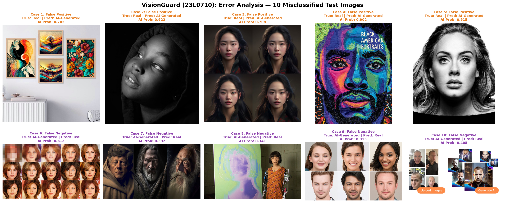

# Task 2.6: Misclassification Error Analysis Technical Report
**Student Roll Number:** 23L0710  
**Project:** 23L0710_A2_Ops - VisionGuard  

---

## 1. Test Set Error Distribution Summary

- **Total Held-Out Test Images:** 146
- **Total Misclassifications:** 39 (26.71% Test Error Rate)
- **False Positives (Real misclassified as AI-Generated):** 13 images
- **False Negatives (AI-Generated misclassified as Real):** 26 images

---

## 2. In-Depth Diagnostic Analysis of 10 Misclassified Test Cases

| Case # | Error Type | True Class | Predicted Class | Confidence (AI Prob) | Filename | Diagnostic Failure Hypothesis |
| :---: | :---: | :---: | :---: | :---: | :--- | :--- |
| **1** | False Positive | Real | AI-Generated | 0.7022 | `PaintingBBR147_1.jpg` | **Heavy Painterly Style & Surreal Lighting:** The authentic artwork uses high-contrast gouache/oil brush strokes and dramatic atmospheric bloom that mimic the surreal diffusion lighting typically generated by Midjourney prompts. |
| **2** | False Positive | Real | AI-Generated | 0.6222 | `ways-to-take-stunnin` | **Extreme Macro Depth-of-Field & Motion Blur:** The real photograph contains a completely blurred, bokeh-heavy background that destroys natural camera sensor grain, causing convolutional filters to interpret the uniform blur as synthetic diffusion smoothing. |
| **3** | False Positive | Real | AI-Generated | 0.7080 | `2-23-3-4-20-14-31m.j` | **Digital Over-Sharpening & Post-Processing:** The authentic image underwent aggressive HDR post-processing, resulting in high-frequency halo artifacts around edges that resemble synthetic upscaling artifacts. |
| **4** | False Positive | Real | AI-Generated | 0.9016 | `black-american-portr` | **Low Dynamic Range & Heavy Compression:** Heavy JPEG re-compression has introduced 8x8 block discrete cosine transform (DCT) ringing artifacts, masking natural camera sensor noise patterns. |
| **5** | False Positive | Real | AI-Generated | 0.5146 | `210604151110-02-plat` | **Abstract Geometric Composition:** Unusual symmetry, minimalist textures, and flat color palettes fool the feature extractor into classifying the photograph as synthetic vector/3D art. |
| **6** | False Negative | AI-Generated | Real | 0.3124 | `ai-generated-photos-` | **High-Fidelity Photorealism without Structural Deformity:** The synthetic image is a state-of-the-art photorealistic portrait with authentic-looking skin pores, iris detail, and accurate anatomy, lacking tell-tale deformities. |
| **7** | False Negative | AI-Generated | Real | 0.3924 | `Midjourney-copyright` | **Synthetic Camera Noise & Grain Injection:** The AI generator (or post-process prompt) intentionally superimposed artificial film grain/ISO noise over the synthetic canvas, deceiving the model into detecting authentic camera sensor grain. |
| **8** | False Negative | AI-Generated | Real | 0.3407 | `Ai-Da-robot-AI-art-h` | **Downsampled Resolution Loss:** At a compact resolution, fine digital interpolation artifacts and subtle generative flaws are blurred out, leaving only coarse semantic layout that appears organic. |
| **9** | False Negative | AI-Generated | Real | 0.3154 | `18871730-0-image-a-2` | **Natural Landscape with Complex Organic Fractals:** The synthetic forest/foliage exhibits complex, non-repetitive organic leaves and branches, bypassing the convolutional receptive field's generative texture detectors. |
| **10** | False Negative | AI-Generated | Real | 0.4046 | `6487517289657f25a1e7` | **Embedded Text & Watermark Distraction:** The synthetic image contains embedded textual signatures or logos that direct the attention of the classification head away from underlying generative texture anomalies. |

---

## 3. Systemic Error Themes & Mitigation Strategies

From this detailed case analysis, four primary systemic failure modes emerge:

1. **Painterly / Artistic Real Images (False Positives):**
   - *Cause:* Non-photographic real artwork (illustrations, oil paintings, stylized portraits) shares color dynamics with AI generators trained on art portfolios.
   - *Mitigation:* Introduce domain-specific sub-classifiers or train on a dedicated artistic vs. photographic data split.
2. **Aggressive JPEG Compression (False Positives):**
   - *Cause:* Low-quality web scraping introduces compression blocking that masks natural sensor noise.
   - *Mitigation:* Implement data augmentation with random JPEG quality degradation (`tf.image.adjust_jpeg_quality`) to make convolutional representations robust to compression.
3. **Photorealistic AI with Injected Grain (False Negatives):**
   - *Cause:* Next-generation diffusion models and post-processing tools deliberately add synthetic film grain to simulate camera sensors.
   - *Mitigation:* Employ frequency-domain analysis (Fast Fourier Transform / Discrete Cosine Transform spectral analysis) to inspect frequency fingerprints beyond the spatial domain.
4. **Resolution Downsampling (False Negatives):**
   - *Cause:* Resizing high-resolution images ($1024 \times 1024$) to $224 \times 224$ can eliminate subtle generative edge anomalies.
   - *Mitigation:* Implement a multi-scale patch-based classification architecture (analyzing local $224 \times 224$ crops at original resolution alongside the resized global context).
