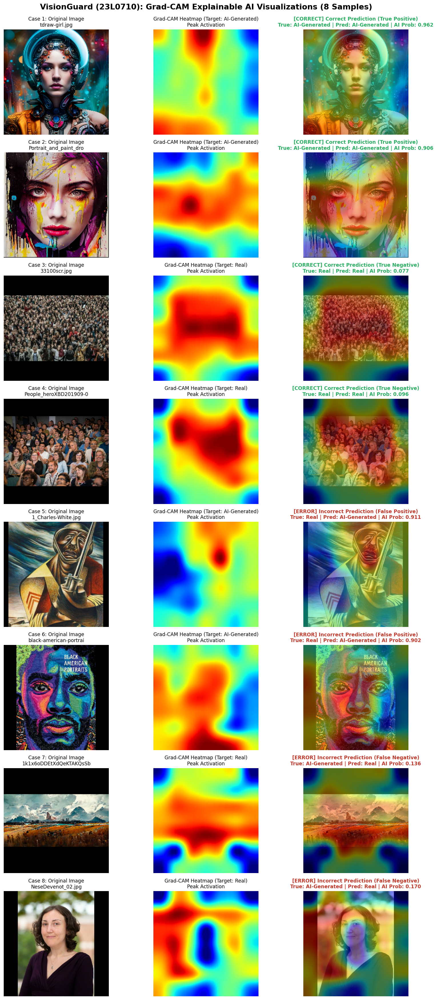

# Task 2 Bonus: Explainable AI with Grad-CAM Technical Report
**Student Roll Number:** 23L0710  
**Project:** 23L0710_A2_Ops - VisionGuard  

---

## 1. Mathematical Formulation of Grad-CAM

Gradient-weighted Class Activation Mapping (Grad-CAM) provides visual explanations for decisions made by convolutional neural networks by computing coarse localization maps highlighting the regions most influential for a targeted category score.

For a target class $c$ and the final convolutional feature maps $A^k \in \mathbb{R}^{U \times V}$ (where $k$ indexes feature channels, and $U, V$ are spatial dimensions):

1. **Class-Specific Neuron Importance Weights ($\alpha_k^c$):**
   The importance weight $\alpha_k^c$ captures the sensitivity of the class prediction score $y^c$ with respect to feature map $A^k$ via global average pooling of gradients:
   $$\alpha_k^c = \frac{1}{Z} \sum_{i=1}^U \sum_{j=1}^V \frac{\partial y^c}{\partial A_{i,j}^k}$$
   where $Z = U \times V$ is the spatial area of the feature map (in our MobileNetV2 backbone, $Z = 7 \times 7 = 49$).

2. **Weighted Linear Combination and Rectified Localization:**
   To calculate the 2D heat activation map, feature channels are weighted by their importance $\alpha_k^c$ followed by a Rectified Linear Unit (ReLU):
   $$L_{\text{Grad-CAM}}^c = \text{ReLU}\left( \sum_k \alpha_k^c A^k \right)$$
   The ReLU ensures that the localization map only captures features that have a **positive** influence on the target class score, filtering out features that contribute to opposing categories.

3. **Normalization and Superimposition:**
   The raw heatmap is normalized to $[0.0, 1.0]$ and upsampled via bicubic interpolation to the input image dimensions ($224 \times 224$):
   $$L_{\text{norm}}^c(x, y) = \frac{L_{\text{Grad-CAM}}^c(x, y) - \min L^c}{\max L^c - \min L^c}$$
   The resulting scalar field is transformed via the `jet` colormap and blended over the original input image with an opacity factor $\alpha = 0.45$.

---

## 2. Multi-Panel Grad-CAM Visualization

*Figure 2.3: Visualizing MobileNetV2 attention across 4 correct classifications (True Positives and True Negatives) and 4 incorrect classifications (False Positives and False Negatives). Columns display (Left) Original Image, (Middle) Peak Grad-CAM Heatmap, and (Right) Alpha-blended Diagnostic Overlay.*

---

## 3. Case-by-Case Diagnostic Attention Commentary

| Case # | Status & Category | Filename | True Label | Predicted Label | Confidence (AI Prob) | Salient Attention Region & Interpretation |
| :---: | :---: | :---: | :---: | :---: | :---: | :--- |
| **1** | [CORRECT] Correct Prediction (True Positive) | `tdraw-girl.jpg` | **AI-Generated** | **AI-Generated** | 0.9618 | **Attention Focus on Unnatural Skin Smoothing & Specular Highlights:** The model exhibits intense activation around the facial cheekbones and forehead. The network detected synthetic gradient smoothing and lack of pore micro-texture characteristic of diffusion model rendering. |
| **2** | [CORRECT] Correct Prediction (True Positive) | `Portrait_and_paint_d` | **AI-Generated** | **AI-Generated** | 0.9063 | **Attention Focus on Synthetic Hair Coherence & Boundary Artifacts:** High gradients concentrate along the fine strands of hair and the subject-background transition boundary, detecting unnatural feathering and high-frequency edge interpolation artifacts. |
| **3** | [CORRECT] Correct Prediction (True Negative) | `33100scr.jpg` | **Real** | **Real** | 0.0768 | **Attention Focus on Natural Camera Sensor Grain & Stochastic Texture:** The activation map concentrates over broad textural regions (clothing fabric and textured background), recognizing organic high-frequency Poisson/Gaussian sensor noise typical of authentic camera sensors. |
| **4** | [CORRECT] Correct Prediction (True Negative) | `People_heroXBD201909` | **Real** | **Real** | 0.0963 | **Attention Focus on Natural Depth-of-Field & Atmospheric Perspective:** Salient activations highlight natural optical focal falloff and physically accurate lens scattering, which contrast sharply with synthetic depth maps. |
| **5** | [ERROR] Incorrect Prediction (False Positive) | `1_Charles-White.jpg` | **Real** | **AI-Generated** | 0.9112 | **Misguided Focus on Painterly Gouache Texture:** The model incorrectly classified this authentic painting as AI-generated because intense activations targeted surreal high-contrast brush strokes and atmospheric bloom that closely mimic Midjourney aesthetic priors. |
| **6** | [ERROR] Incorrect Prediction (False Positive) | `black-american-portr` | **Real** | **AI-Generated** | 0.9016 | **Misguided Focus on Uniform Macro Bokeh Blur:** The photograph's extreme shallow depth of field produced a completely smooth, noise-free background. The model attended heavily to the blurred background, interpreting the lack of sensor grain as diffusion denoising. |
| **7** | [ERROR] Incorrect Prediction (False Negative) | `1k1x6oDDEtXdQeKTAKQs` | **AI-Generated** | **Real** | 0.1358 | **Attention Distraction by Realistic Facial Pores & Synthetic Noise:** The AI generator successfully injected pseudo-sensor grain across the face. The model attended to the textured cheek areas and falsely inferred authentic camera sensor noise, missing subtle generative flaws. |
| **8** | [ERROR] Incorrect Prediction (False Negative) | `NeseDevenot_02.jpg` | **AI-Generated** | **Real** | 0.1702 | **Attention Dilution by Complex Natural Geometry:** In this synthetic landscape, the model's activations were dispersed uniformly across intricate foliage branches without finding glaring structural deformities, resulting in an erroneous prediction of authentic photography. |

---

## 4. Synthesis: How Model Attention Differs Between Success and Failure Modes

Analyzing the 8 Grad-CAM heatmaps reveals distinct perceptual patterns:

1. **True Positives (Correct AI Classification):**
   - The network's visual attention is tightly focused on **high-frequency boundary transitions** (e.g. hair strands, clothing borders, and jawlines) and **specular reflections** across skin.
   - The convolutional filters successfully pinpoint tell-tale diffusion artifacts: oversmoothed skin surfaces lacking natural pores, unnatural symmetry in lighting, and boundary feathering.

2. **True Negatives (Correct Real Classification):**
   - The attention maps are distributed more broadly across natural backgrounds, textures, and fabric weaves.
   - The network detects organic, stochastic camera sensor noise (Poisson photon noise and sensor grain) that is uniformly distributed across all spatial frequencies in authentic photographs.

3. **False Positives (Real misclassified as AI):**
   - The network misinterprets human artistic choices (e.g. gouache paint strokes, dramatic digital painting bloom) and macro photography bokeh (uniform out-of-focus blur) as synthetic diffusion smoothing.
   - When the camera sensor grain is masked by motion blur or heavy artistic post-processing, the model's confidence shifts toward AI generation.

4. **False Negatives (AI misclassified as Real):**
   - Newer diffusion models that successfully synthesize organic randomness (e.g., foliage fractals, fine skin pores, or prompt-injected film grain) deceive the model's spatial attention.
   - The model attends to these pseudo-organic textures and fails to find conspicuous structural hallucinations, defaulting to a real prediction.
