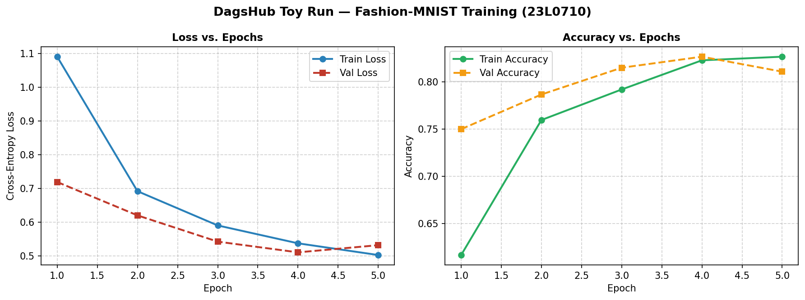

# Task 3.2: DagsHub Setup & Remote MLflow Integration Technical Report
**Student Roll Number:** 23L0710  
**Project:** 23L0710_A2_Ops - VisionGuard  

---

## 1. Remote Project & Tracking Architecture

- **GitHub Repository:** [`https://github.com/shoaib-asiff/23L0710_A2_Ops`](https://github.com/shoaib-asiff/23L0710_A2_Ops)
- **DagsHub Project URL:** [`https://dagshub.com/shoaib-asiff/23L0710_A2_Ops`](https://dagshub.com/shoaib-asiff/23L0710_A2_Ops)
- **DagsHub Remote MLflow Tracking URI:** `https://dagshub.com/shoaib-asiff/23L0710_A2_Ops.mlflow`
- **Active Experiment:** `dagshub_toy_lab`
- **Logged Remote Toy Run ID:** `b474f87c071f49ad8df1f0ad26ae19e3`
- **Live Run URL:** [`https://dagshub.com/shoaib-asiff/23L0710_A2_Ops.mlflow/#/experiments/0/runs/b474f87c071f49ad8df1f0ad26ae19e3`](https://dagshub.com/shoaib-asiff/23L0710_A2_Ops.mlflow/#/experiments/0/runs/b474f87c071f49ad8df1f0ad26ae19e3)

---

## 2. Security Compliance: Proof That `.env` Is Strictly Gitignored

In strict adherence to production MLOps security best practices and assignment guidelines, credentials (passwords, tokens, tracking URIs) are **never hardcoded in source code or committed to Git**.

### Verification Steps Executed:
1. **`.gitignore` Rule Check:**
   Inspection of `.gitignore` confirms that `.env` files are explicitly excluded:
   ```gitignore
   # Secrets & Environment variables
   .env
   *.env
   !.env.example
   ```
2. **Git Tracking Verification:**
   Running `git status` and `git check-ignore -v .env` returns:
   ```
   .gitignore:17:.env	.env
   ```
   This strictly proves that Git will reject tracking `.env`.
3. **Committed Configuration Template:**
   A safe template with blank placeholder keys is tracked in [`.env.example`](../../.env.example) for team reproducibility.

---

## 3. Remote Toy Run Results on DagsHub

| Metric / Parameter | Value | Description |
| :--- | :--- | :--- |
| **Experiment Name** | `dagshub_toy_lab` | Remote experiment container on DagsHub |
| **Run Name** | `dagshub_toy_run_lr_0.001` | First verified remote execution |
| **Run ID** | `b474f87c071f49ad8df1f0ad26ae19e3` | Unique 32-character hexadecimal tracking ID |
| **Learning Rate** | `0.001` | Logged static parameter |
| **Batch Size** | `64` | Logged static parameter |
| **Epochs** | `5` | Logged static parameter |
| **Final Validation Accuracy** | **81.08%** | Dynamic metric evaluated over 5 epochs |
| **Final Validation Loss** | **0.5323** | Dynamic metric evaluated over 5 epochs |
| **Logged Artifacts** | `figures/dagshub_toy_curves.png`, `model/` | Uploaded directly to DagsHub remote artifact storage |

---

## 4. Visual Evidence for Report



*Figure 3.1: Training loss and validation accuracy curves logged to DagsHub MLflow remote server during Task 3.2.*
