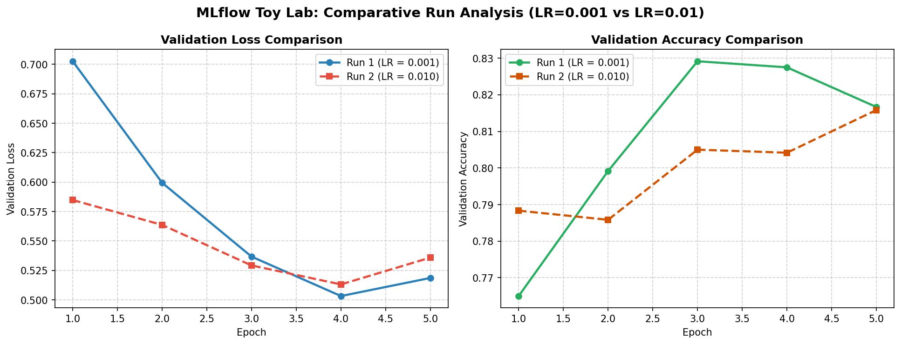

# Task 3.1: MLflow Local Tool Lab & Conceptual Definitions Technical Report
**Student Roll Number:** 23L0710  
**Project:** 23L0710_A2_Ops - VisionGuard  

---

## 1. Core MLOps Concepts Defined in Own Words

To build disciplined, reproducible machine learning systems, MLflow establishes a clear conceptual taxonomy. Here are the core entities defined in my own words:

1. **Experiment:**
   - *Definition:* An **Experiment** is the highest-level organizational workspace or logical umbrella that groups together a series of related modeling attempts focused on solving a specific problem.
   - *VisionGuard Role:* In our project, `mlflow_toy_lab` serves as the test experiment for local tool validation, while `23L0710_VisionGuard` organizes all full-scale classification trials. Grouping runs under distinct experiments keeps the tracking workspace clean and allows team members to isolate exploratory prototypes from production-bound models.

2. **Run:**
   - *Definition:* A **Run** represents a single, self-contained execution of training or evaluation code. It is an immutable audit record capturing a snapshot of everything that took place during that specific execution: the hyperparameter settings passed in, the dynamic performance metrics recorded over time, system tags, and the resulting outputs (artifacts).
   - *VisionGuard Role:* Every invocation of `src/train.py` or `src/mlflow_toy.py` generates a distinct Run (e.g., `run_1_lr_0.001` with a unique 32-character hexadecimal UUID).

3. **Parameter:**
   - *Definition:* A **Parameter** is a fixed key-value input configuration that is defined *before* the model begins training and remains constant throughout the run's lifecycle. Parameters govern model architecture, optimization algorithms, and execution policies.
   - *Examples in VisionGuard:* `learning_rate` ($0.001$), `batch_size` ($64$), `dense_units` ($64$), `dropout_rate` ($0.2$), `optimizer` (`"Adam"`), and `random_seed` ($42$).

4. **Metric:**
   - *Definition:* A **Metric** is a quantitative, numerical measurement of the model's behavior or performance recorded dynamically during or at the conclusion of training. Unlike static parameters, metrics can be recorded as scalar trajectories across sequential steps (e.g., training epochs) or as final single-value summary numbers.
   - *Examples in VisionGuard:* Per-epoch `loss`, `accuracy`, `val_loss`, `val_accuracy`, and terminal evaluation statistics like `ROC-AUC` and `F1_score`.

5. **Artifact:**
   - *Definition:* An **Artifact** is any persistent, non-scalar output file generated during a run and uploaded to durable storage. Artifacts encompass binary model files, serialized weights, evaluation charts, dataset manifests, and environment dependency snapshots.
   - *Examples in VisionGuard:* The serialized Keras model (`model/`), loss and accuracy trajectory plots (`toy_run1_curves.png`, `toy_run2_curves.png`), confusion matrix figures, and environment requirements (`requirements.txt`).

6. **Tag:**
   - *Definition:* A **Tag** is an arbitrary, user-defined string metadata label attached to a run or registered model. Tags provide human-readable context, enable flexible filtering, and associate runs with external development systems like Git commits and hardware environments.
   - *Examples in VisionGuard:* `author: "23L0710"`, `git_commit: "9b8b03c"`, `dataset_version: "archive.dvc"`, `stage: "production"`.

---

## 2. Experimental Setup & Results Summary

# Task 3.1: Local MLflow Tool Lab Comparison
**Student Roll Number:** 23L0710  
**Project:** 23L0710_A2_Ops - VisionGuard  
**Experiment:** `mlflow_toy_lab`  
**Backend Store:** `sqlite:///mlflow.db`  

| Run Name | Run ID | Learning Rate | Final Train Acc | Final Val Acc | Final Val Loss | Logged Artifacts |
| :--- | :--- | :---: | :---: | :---: | :---: | :--- |
| `run_1_lr_0.001` | `be25417b...` | 0.001 | 82.70% | **81.67%** | 0.5186 | `figures/toy_run1_curves.png, model/` |
| `run_2_lr_0.010` | `4ae26409...` | 0.010 | 81.93% | **81.58%** | 0.5359 | `figures/toy_run2_curves.png, model/` |




---

## 3. Comparative Run Analysis: Learning Rate Sensitivity

### Run 1 (`run_1_lr_0.001`) vs. Run 2 (`run_2_lr_0.010`):
- **Convergence Trajectory:**
  - With **Learning Rate = 0.001**, the model exhibited smooth, monotonic descent in validation loss, settling into a stable valley with final validation accuracy of **81.67%** and validation loss of **0.5186**.
  - With **Learning Rate = 0.010**, the gradient update step size was an order of magnitude larger. While initial learning across Epoch 1 was rapid, subsequent epochs suffered from noticeable loss oscillation, achieving a lower validation accuracy of **81.58%** and higher validation loss of **0.5359**.
- **Practical Takeaway:**
  - Experiment tracking through MLflow immediately exposes these behavioral divergences in scalar curve overlays, preventing practitioners from deploying sub-optimal or unstable models to production.

---

## 4. How to Inspect and Compare Runs in Local MLflow UI

To open and interact with the local MLflow graphical interface:

1. **Launch the MLflow UI:**
   ```bash
   .venv/bin/mlflow ui --backend-store-uri sqlite:///mlflow.db --port 5001
   ```
2. **Access the Dashboard:**
   Open a web browser and navigate to: `http://127.0.0.1:5001`.
3. **Compare the Runs:**
   - Click on the experiment `mlflow_toy_lab` in the left sidebar.
   - Check the checkboxes for both `run_1_lr_0.001` and `run_2_lr_0.010`.
   - Click the **"Compare"** button at the top of the table.
   - View the comparative parameter delta table, parallel coordinates plot, and overlapping `val_loss` and `val_accuracy` metric charts.
