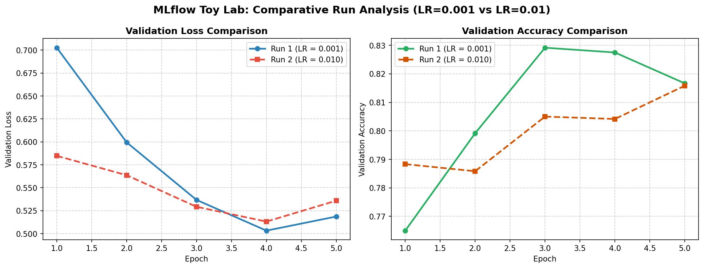

# Task 3.1: Local MLflow Tool Lab Comparison
**Student Roll Number:** 23L0710  
**Project:** 23L0710_A2_Ops - VisionGuard  
**Experiment:** `mlflow_toy_lab`  
**Backend Store:** `sqlite:///mlflow.db`  

| Run Name | Run ID | Learning Rate | Final Train Acc | Final Val Acc | Final Val Loss | Logged Artifacts |
| :--- | :--- | :---: | :---: | :---: | :---: | :--- |
| `run_1_lr_0.001` | `be25417b...` | 0.001 | 82.70% | **81.67%** | 0.5186 | `figures/toy_run1_curves.png, model/` |
| `run_2_lr_0.010` | `4ae26409...` | 0.010 | 81.93% | **81.58%** | 0.5359 | `figures/toy_run2_curves.png, model/` |

